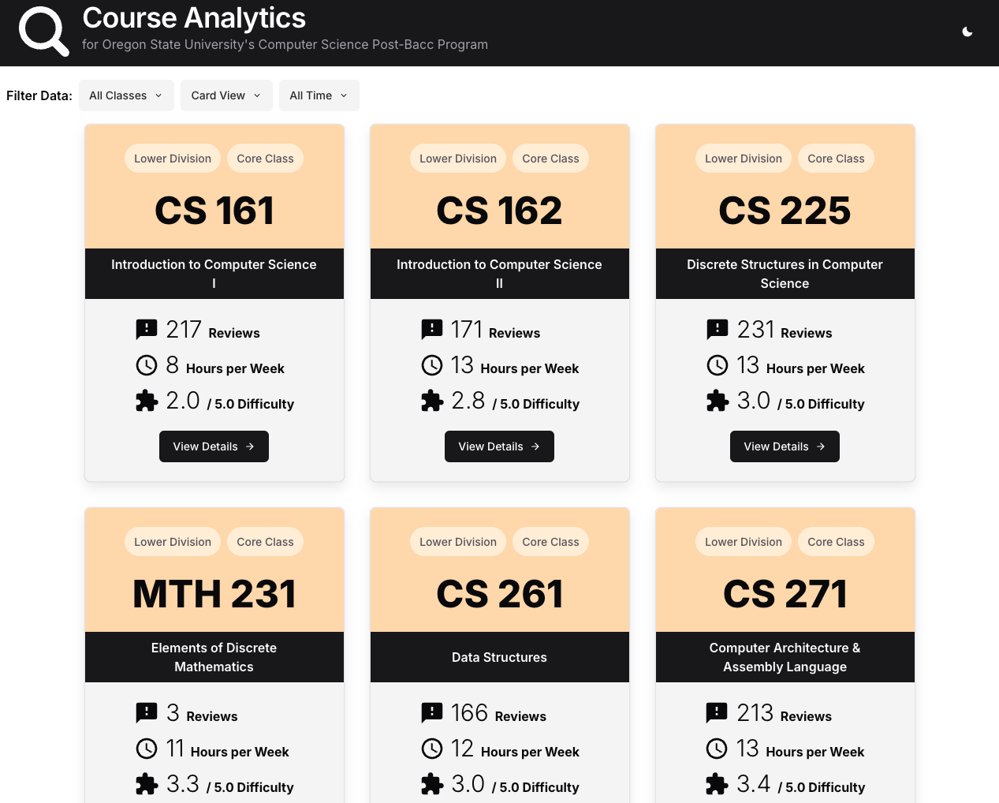

# 🔍 [Course Analytics](https://www.osu-cs-ca.com/)



Course Analytics was developed for students of Oregon State University's Computer Science program. It provides students with aggregated data and tips to help students understand the difficulty, time commitment, common course pairings. The data has been submitted by real students using [this survey](https://docs.google.com/forms/d/e/1FAIpQLSeAWZa_OWYqwOte5yw4loGgE6hEUqOJOeSpmzStZF_HcufufQ/viewform). Feel free to add your own reviews if you are a current student! The data is scraped from [this spreadsheet](https://docs.google.com/spreadsheets/d/1MFBGJbOXVjtThgj5b6K0rv9xdsC1M2GQ0pJVB-8YCeU/edit#gid=2042942971).

# 📞 API Calls

At this time, the API does not require an API key. Make requests by making http get requests to the desired URI.

URIs are relative to the hosting domain, currently: `https://www.osu-cs-ca.com`

## Get Course Summary Data

Get all course summaries using:

`/api/summary/`

Get a specific course summary using:

`/api/summary/CS-<number>`

Where `<number>` is the course number. For example, to get the course summary for CS 271, use:

`/api/summary/CS-271`

## Get Course Review Data

Get all course review data using:

`/api/courses/`

Get specific course review data using:

`/api/courses/CS-<number>`

Where `<number>` is the course number. For example, to get the course summary for CS 271, use:

`/api/courses/CS-271`

# ⚙️ Development

## Prerequisites

1. [Node.js](https://nodejs.dev/learn/how-to-install-nodejs), v16.13.1 (recommended) or higher
2. [npm](https://docs.npmjs.com/downloading-and-installing-node-js-and-npm), v8.x (recommended) or higher
3. A MongoDB replica set: a free [MongoDB Atlas](https://www.mongodb.com/atlas) cluster or a local single-node replica set (see Configure)

## Install

Download the current codebase or create a fork. Navigate to the root of the project directory in your terminal window and call `npm install`. This will install the required node module dependencies into your project folder.

## Configure

Copy `.env.example` to `.env.local` in the root of the project directory and fill in the values. Every command that loads the app (`npm run dev`, `npm run build`, `npm start`) fails with a list of whichever variables are missing.

Running the site locally needs your own database, and the only way to fill it is the scraper. That is why all four variables are required. The Google values come from a service account with access to the survey sheet. `CRON_KEY` is the value `/api/scrape` expects in the `Authorization` header. It can be any string if you only scrape with `npm run scrape-dev`.

The scraper replaces all stored reviews in one transaction, so a failed scrape leaves the old data in place. MongoDB only supports transactions on a replica set, so `MONGODB_URI` must point to one. A free MongoDB Atlas cluster works. For a local database, start a single-node replica set with Docker:

```sh
docker run -d --name course-analytics-mongo -p 27017:27017 mongo:8 --replSet rs0
docker exec course-analytics-mongo mongosh --quiet --eval 'rs.initiate()'
```

Then set `MONGODB_URI=mongodb://localhost:27017/course-analytics?directConnection=true`. A standalone `mongod` fails the scrape with an error that names this requirement.

For more information on the key/value pairs from Google, additional information is available on the [Develop on Google Workspace](https://developers.google.com/workspace/guides/get-started) product documentation site. This explains how to obtain the data necessary to start developing using Google APIs.

## Run

After setting up the `.env.local` file, call `npm run scrape-dev` to scrape data from the Google Sheets spreadsheet and populate the MongoDB database.

Next, call `npm run dev`. This will start the Next.js server in development mode.

Finally, open a browser window and navigate to `localhost:3000`. This is the Next.JS project running in your browser.

## Testing

Course Analytics uses [Vitest](https://vitest.dev/) and [Testing Library](https://testing-library.com/). Tests live in `tests/`. Files ending in `.test.ts` run in Node, and files ending in `.test.tsx` run in jsdom.

Run the suite with `npm test`. CI also runs `npm run format:check` and `npm run typecheck` on every pull request, and Vercel builds a preview of each one.
