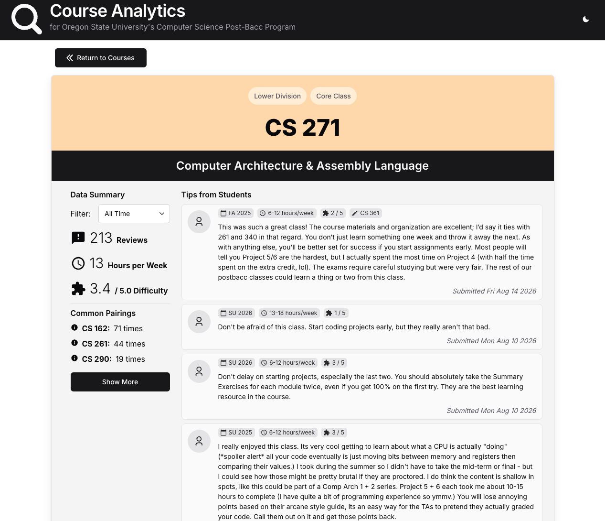

# 🔍 [Course Analytics](https://www.osu-cs-ca.com/)

Course Analytics was developed for students of Oregon State University's Computer Science program. It provides students with aggregated data and tips to help students understand the difficulty, time commitment, common course pairings. The data has been submitted by real students using [this survey](https://docs.google.com/forms/d/e/1FAIpQLSeAWZa_OWYqwOte5yw4loGgE6hEUqOJOeSpmzStZF_HcufufQ/viewform). Feel free to add your own reviews if you are a current student! The site reads the data from [this spreadsheet](https://docs.google.com/spreadsheets/d/1MFBGJbOXVjtThgj5b6K0rv9xdsC1M2GQ0pJVB-8YCeU/edit#gid=2042942971).

# 📞 API Calls

At this time, the API does not require an API key. Make requests by making http get requests to the desired URI. Responses can be up to five minutes old.

URIs are relative to the hosting domain, currently: `https://www.osu-cs-ca.com`

## Get Course Summary Data

Get all course summaries using:

`/api/summary/`

Get a specific course summary using:

`/api/summary/CS-<number>`

Where `<number>` is the course number. For example, to get the course summary for CS 271, use:

`/api/summary/CS-271`

## Get Course Review Data

Get all course review data using:

`/api/courses/`

Get specific course review data using:

`/api/courses/CS-<number>`

Where `<number>` is the course number. For example, to get the course summary for CS 271, use:

`/api/courses/CS-271`

# ⚙️ Development

## Prerequisites

[Node.js](https://nodejs.org/) 24, which includes npm. The version is pinned in `package.json` and `.tool-versions`.

## Install

Download the current codebase or create a fork. Navigate to the root of the project directory in your terminal window and call `npm install`. This will install the required node module dependencies into your project folder.

## Run

Call `npm run dev`, then open `localhost:3000` in a browser. No configuration is needed. The site reads the reviews from the public survey spreadsheet and reuses each download for five minutes.

## Testing

Course Analytics uses [Vitest](https://vitest.dev/) and [Testing Library](https://testing-library.com/). Tests live in `tests/`. Files ending in `.test.ts` run in Node, and files ending in `.test.tsx` run in jsdom.

Run the suite with `npm test`. CI also runs `npm run format:check` and `npm run typecheck` on every pull request, and Vercel builds a preview of each one.
